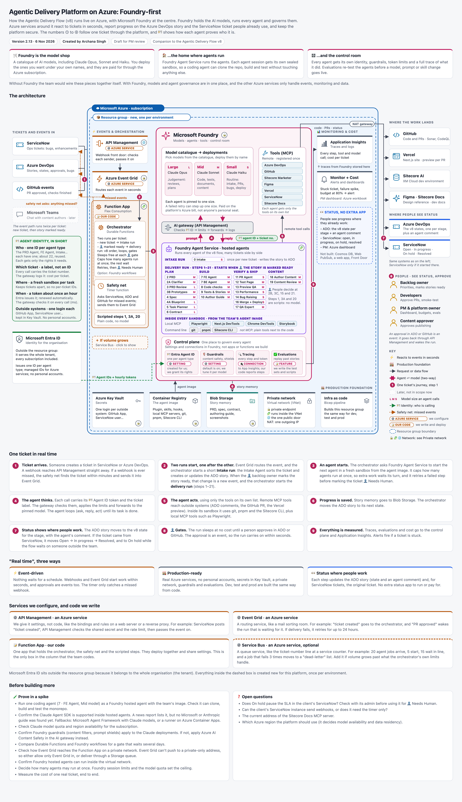
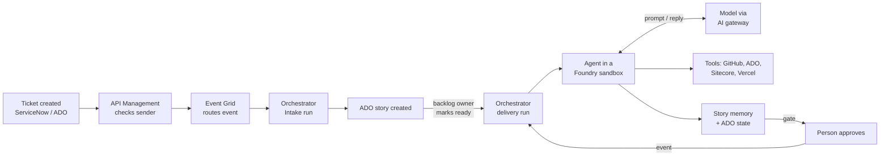

# Agentic Delivery Platform on Azure: Architecture Guide

6 Nov 2026 · Created by Archana Singh

This guide explains, in plain words, how the Agentic Delivery Flow runs on Microsoft Azure, with Microsoft Foundry at the centre. It is written for anyone who finds the architecture diagram hard to read on its own. After reading it, you should know what each part of the platform is for and what happens at every step when a ticket arrives.

## About this document

- **Status:** a design for review, not a running system. Nothing here is built yet.
- **Companion diagram:** [`agentic-architecture-v2.13.html`](../diagram-versions/agentic-architecture-v2.13.html) (open it in a browser) and the image [`agentic-architecture-v2.13.png`](../diagram-versions/agentic-architecture-v2.13.png).
- **Related:** the Agentic Delivery Flow [`agentic-flow-v8.html`](../diagram-versions/agentic-flow-v8.html) describes *what* the agents do, step by step. This guide describes *where and how* that flow runs on Azure.
- **How it's organised:**
  - Sections 1–3: the idea and how to read the diagram.
  - Sections 4–10: each area of the diagram.
  - Section 11: one ticket, from start to finish.
  - Sections 12–14: failures, settings and security.
  - Sections 15–16: decisions and open items.
  - At the end: a glossary.

---

## 1. The idea in one minute

- **AI agents do the delivery work.** They write the requirements, plan, build components, test, raise PRs and author content.
- **People stay in charge.** They approve at four gates (2B, 3C, 15 and 21) and help whenever an agent gets stuck.
- **Microsoft Foundry is the centre:**
  - it **hosts the AI models** (Claude Opus, Sonnet and Haiku);
  - it **runs every agent** in its own sealed sandbox;
  - it **governs them**: identity, guardrails, tracing and evaluations.
- **A small amount of our own code runs the flow in order.** The orchestrator follows the v8 steps, counts loops and waits at gates. AI makes the judgement calls inside the steps.
- **It reacts in real time.** A new ticket or an approval starts work within seconds; nothing waits for a schedule.
- **Status shows where people already work.** The Azure DevOps story and, when the work came from ServiceNow, the ServiceNow ticket. There is no separate status app.
- **It's built for production:**
  - no personal accounts;
  - secrets in a vault;
  - a private network;
  - the same setup for dev, test and prod.

## 2. How to read the diagram

The diagram reads **left to right**: tickets come in on the left, the work happens in the middle, and the results land on the right.

| Area on the diagram | What it is |
|---|---|
| Far left: **Tickets and events in** | Where work comes from: ServiceNow, Azure DevOps, GitHub |
| Inside the blue box: **Microsoft Azure · subscription** | Everything we run in Azure |
| Inside the dashed box: **Resource group** | Everything created new for this platform, once per environment (dev, test, prod) |
| Left column: **Events & orchestration** | Receives events and runs the flow in order |
| Centre: **Microsoft Foundry** | Models, agents, tools and the control plane |
| Right column: **Monitoring & cost** | Traces, alerts, budgets and a dashboard for the PM |
| Far right | **Where the work lands** (GitHub, Vercel, Sitecore), **where people see status** (ADO, ServiceNow) and **the people** |
| Bottom band: **Production foundation** | Secrets, the agent image, story memory, the private network and infra as code |
| Left, under the sources | **Agent identity** explained, and **Microsoft Entra ID** |

**Symbols used on the diagram**

| Symbol | Meaning |
|---|---|
| ① to ⑨ (red circles) | One ticket's journey, in order (section 11) |
| Solid grey arrow | A request or data flow |
| Pink two-way arrow | An agent talking to a model (prompt and reply) |
| Green dashed arrow 🪪 | Identity: who is calling |
| Orange dotted arrow | The safety net checking for missed events |
| ⚙️ **AZURE SERVICE** tag | A service we only configure, with no code of ours inside |
| 📝 **OUR CODE** tag | Code the team writes and deploys |
| 🌐 badge | The one public door |
| 🔒 badge | Private endpoint: the service has an internal-only address |
| 🧩 badge | Runs inside the private network |
| L / M / S | The model size an agent uses (Large, Mid, Small) |
| 👤 | A person decides or acts |
| Dashed, faded box | Later, or optional |

## 3. Who does what

| Who | Their part |
|---|---|
| **AI agents** (about 22, one per step type) | Do the work at each step. Each has one job, one model size and its own tool list |
| **The orchestrator** (our code) | Runs the steps in the v8 order, counts loops, waits at gates, updates states |
| **Scripts** (steps 1, 3A, 20) | Predictable work that needs no AI |
| **Backlog owner** | Sets priorities, marks stories ready, confirms story details (gate 2B) |
| **Developers** | Approve PRs (gate 15), smoke-test |
| **Content approver** | Approves publishing (gate 21) |
| **PM and platform owner** | Watch cost and quality, set budgets, approve model changes |

---

## 4. Tickets and events in

- **ServiceNow:** ops tickets such as bugs and enhancements. When a ticket is created, a ServiceNow business rule sends a message (a webhook) to the platform.
- **Azure DevOps:** stories, their states and approvals. Changes are sent through ADO **service hooks**.
- **GitHub:** events such as "PR approved" or "checks finished", sent by the **GitHub App's webhook**.
- **Microsoft Teams:** a later idea for chatting with content authors. It's not in scope now.

**The event path runs twice for each ticket:**
1. When the ticket is **new**, it starts the short Intake run.
2. When the backlog owner **marks the story ready**, it starts the delivery run.

## 5. Events and orchestration

This column receives events and runs the flow. Only one box in it is our own code.

### API Management: the front door (⚙️ Azure service, 🌐 public door)

- The **only address outside systems can reach**. Everything else has no public address.
- Like a reception desk, it:
  - checks the sender is real (a shared secret, or GitHub's signature);
  - accepts only known paths;
  - limits how many calls arrive at once;
  - logs every call;
  - converts each system's message into one standard event shape.
- It then passes the event to Event Grid.
- It's configured with settings and short policy rules, not code.

### Azure Event Grid: the sorting room (⚙️ Azure service, 🔒 private endpoint)

- **Routes each event** to whoever needs it, within seconds.
  - Example: "ticket created" starts a new run; "PR approved" wakes the run that was waiting for it.
- If delivery fails, it **retries for up to 24 hours**.

### Function App: our code (📝 our code, 🧩 inside the network)

One app, on the Flex Consumption plan, that holds three things deployed together.

**Orchestrator** (Azure Durable Functions)
- Runs **two runs per ticket**:
  - a short **Intake run** when the ticket is new;
  - the **delivery run** (steps 1–21) when the story is marked ready.
- Follows the **v8 order**, counts loops (3 rounds at most) and sets the ADO state at each stage.
- **Sleeps at no cost** at each 👤 gate, for days if needed, and wakes when the approval event arrives.
- **Limits how many agents run at once**; the rest wait their turn.
- **Retries** a failed step, then marks the ticket 👤 **Needs Human**.
- An option to compare in the spike: **Foundry workflows** instead of Durable Functions.

**Safety net** (a timer function)
- Webhooks can occasionally be lost: a system is briefly down, or a hook is switched off.
- Every few minutes the safety net **asks ServiceNow, ADO and GitHub: "anything new I haven't seen?"** That's the orange dotted lines.
- It **sends anything missed into Event Grid**, so it follows the normal path. It doesn't go through API Management, because it's already inside Azure.
- Each event is handled **only once**, so nothing is processed twice.

**Scripted steps 1, 3A and 20**
- Plain code with no model, for predictable work.

**Why the orchestrator is code, not an AI agent:**
- The flow's rules (order, loop limits, gates) must hold **every time**.
- Code follows them exactly, waits for days at no cost, and is cheap and easy to audit.
- AI makes the judgement calls *inside* the steps. For example, the Intake Agent classifies the ticket and the Contract Agent can send a plan back.

### Optional, if volume grows: Azure Service Bus

- A **queue** between the orchestrator and the agents.
  - Example: 20 agent jobs arrive, 5 start, and 15 wait in line.
- A job that fails 3 times moves to a **"dead-letter" list** for a person to look at.
- It's **not in the default design**, because the orchestrator's own limits and retries are enough at pilot size.
- On the diagram, click the dashed **"If volume grows"** box under the Function App to show it.

## 6. Microsoft Foundry

Foundry is the model shop, the home where agents run, and the control room, all in one place.

### Model catalogue → deployments

- You pick models from Foundry's catalogue and **deploy them under your own names**, with pinned versions.

| Size | Model | Used for |
|---|---|---|
| **Large (L)** | Claude Opus | Judgement: reviews, plans, the blueprint, the contract |
| **Mid (M)** | Claude Sonnet | Code, tests, documents, content |
| **Small (S)** | Claude Haiku | Routine work: intake, PRs, bugs, deploys |

- Each agent is **pinned to one size**. A failed retry can step up one size.
- Models are **paid through the platform's Azure bill**, not anyone's personal seat.

### AI gateway (API Management)

Sits between the agents and the models. On every call it:
1. **checks the agent's identity** (🪪 Agent ID);
2. **applies limits**: tokens per agent, quotas;
3. **forwards** to the pinned model, with failover if it's busy;
4. **logs** the call, with the ticket number, so cost per ticket can be reported.

### Tools (remote MCP)

- **MCP servers** for outside systems are **registered once** in Foundry:
  - Azure DevOps, GitHub, Sitecore Marketer, Figma, Vercel, ServiceNow, Sitecore Docs.
- **Each agent gets only the tools on its own list.**
  - Example: the PRD Agent gets ADO and Docs; the PR Agent gets GitHub.

### Foundry Agent Service: hosted agents (🧩 inside the network)

- **Runs every agent** of the v8 flow, many tickets side by side.
- **Each agent session gets a fresh, sealed sandbox**, started from the team's **agent image**. When the step ends, the sandbox is thrown away.
- **Intake run** (once per new ticket): the **0 Intake** agent (Small) sorts the ticket and writes the story to ADO.
- **Delivery run** (steps 1–21), which starts when 👤 the story is marked ready:

| Phase | Agents (model size) |
|---|---|
| **Plan** | 2 PRD (M), 2A Clarifier (M), 3 PRD Review (L), 3B Prototypes (M), 4 Spec (M), 4A Blueprint (L), 5 Task Planner (L), 6 Contract (L) |
| **Build** | 7 FE Agent (M), 7 BE Agent (M), 8 Code checks (M), 9 Tests & Stories (M), 10 Author Guide (M) |
| **Verify & ship** | 11 PR Agent (S), 12 Test Page (M), 13 Preview QA (M), 13 Performance (S), 14 Bug Raising (S), 16 Merge + Deploy (S), 17 QA Expert (M) |
| **Content** | 18 Author Content (M), 19 Content Review (M) |

- **Gates:** people decide at 2B, 3C, 15 and 21.
- **Scripts:** steps 1, 3A and 20 run without a model.

**Inside every sandbox** (from the agent image):
- **Local MCP servers:** Playwright, Next.js DevTools, Chrome DevTools, Storybook. They run next to the code.
- **Command line tools:** git, pnpm, Sitecore CLI. These are plain tools, not MCP.

### Control plane

These are **settings and connections inside Foundry**, not apps or functions we build.

| Part | Kind | What it does | Our part |
|---|---|---|---|
| 🪪 **Entra Agent ID** | ⚙️ Setting | One identity per agent type | Created for us; we grant its rights |
| 🛡️ **Guardrails** | ⚙️ Setting | Content safety and prompt shields | On by default; we tune it per model |
| 🔍 **Tracing** | 🔌 Connection | Records every step, tool call and token | Connected to Application Insights; our code reports its steps |
| ✅ **Evaluations** | 📝 Feature | Replays past stories to test agents | We write the test sets and scripts |

## 7. Monitoring and cost

- **Application Insights:** every step, tool call and model call, as it happens, plus **cost per ticket** from the gateway logs. Foundry's traces are stored here.
- **Monitor + Cost:**
  - **alerts**, e.g. a stuck ticket, a spike in failures, or the budget at 80%;
  - **budgets**;
  - a **PM dashboard** (an Azure workbook).
- **No extra status app.** A live "Control Centre" (Cosmos DB, Web PubSub, a web app and Front Door) was considered and left out, because the same information shows in ADO and ServiceNow at no extra cost.

## 8. Where the work lands, and where people see status

**Where the work lands** (all calls leave through the **NAT gateway**, one fixed outgoing IP address):
- **GitHub:** code and PRs. SonarQube and CodeQL still check every PR.
- **Vercel:** the Next.js site, with a preview per PR.
- **Sitecore AI (XM Cloud):** the dev environment.
- **Figma and Sitecore Docs:** design reference and developer docs.

**Where people see status:**
- **Azure DevOps:** the story moves through the **states defined in the Agentic Delivery Flow v8**, one per stage, and each agent adds a comment.
- **ServiceNow** (only when the work started there):
  - **Open** when the ADO story is created;
  - **In progress** while the flow works, or waits on the team's own approvals;
  - **On hold** while it waits on someone outside the team;
  - **Resolved** when the story is Done.
- An approval in ADO or GitHub is itself an event. It goes back through API Management and wakes the run within seconds.

## 9. The production foundation

| Part | Plain meaning | What it holds here |
|---|---|---|
| **Azure Key Vault** (🔒) | A safe for secrets | One login per outside system: the GitHub App key, the ServiceNow integration user, the Sitecore automation client, Figma and Vercel tokens, webhook secrets. Agents read them using their identity; every read is logged |
| **Container Registry** (🔒) | A shelf of versioned "laptop builds" | The **agent image**: Node, pnpm, git, the Sitecore CLI, the plugin (skills, hooks, instructions) and the local MCP servers. No secrets and no client code; the code is cloned fresh in each sandbox |
| **Blob Storage** (🔒) | A shared drive, one folder per ticket | **Story memory**: the PRD, spec, contract, authoring guide and screenshots. Sandboxes are thrown away, so each agent saves its outputs here for the next one |
| **Private network** (VNet) | Internal corridors | 🔒 private endpoints, 🧩 services inside the network, 🌐 one public door, and a NAT gateway for one fixed outgoing IP the client can allow-list. No VPN is needed, because every outside system is a cloud service |
| **Infra as code** (Bicep) | The setup written down as files | Builds this resource group **the same way for dev, test and prod**. Changes go through a PR. It's the same idea as serializing foundational Sitecore items so every environment has the same YMLs |

## 10. Identity and the resource group

**Identity (🪪)**
- **Who:** one ID per agent type (about 22, reused), each with only the rights it needs.
- **Which ticket:** the ticket number travels as a label on every call, not as an ID. The gateway logs it, which gives cost per ticket.
- **Where:** a fresh sandbox per task keeps tickets apart.
- **When:** Entra issues a token about once an hour, renewed automatically. The gateway checks it on every call.
- **Outside systems:** one login each (a GitHub App, a ServiceNow integration user…), kept in Key Vault. No personal accounts.

**Microsoft Entra ID** sits **outside the resource group**, because it belongs to the whole organisation (the tenant), not to one project.

**Resource group:** one new resource group per environment holds everything in the dashed box. Recommended: start in the existing non-prod subscription, and move to dedicated subscriptions before production. Model quota is set per subscription and region.

---

## 11. One ticket, from start to finish

The numbers match the red circles on the diagram.

1. **① The ticket arrives.** Someone creates a ticket in ServiceNow or Azure DevOps. A webhook reaches API Management straight away. If the webhook is ever lost, the safety net finds the ticket within minutes and sends it into Event Grid.
2. **② Two runs start, one after the other.**
   - Event Grid routes the event, and the orchestrator starts the short **Intake run**: the Intake Agent sorts the ticket and creates or updates the ADO story.
   - When the 👤 backlog owner marks the story ready, that change is a new event, and the orchestrator starts the **delivery run** (steps 1–21).
3. **③ An agent starts.**
   - The orchestrator asks Foundry Agent Service to start the next agent, in a fresh sandbox from the agent image.
   - It limits how many agents run at once, so extra work waits its turn.
   - It retries a failed step before marking the ticket 👤 Needs Human.
4. **④ The agent thinks.**
   - Each model call carries the agent's 🪪 ID token and the ticket label.
   - The AI gateway checks them, applies the limits and forwards the call to the agent's model.
   - The agent repeats ask, reply and act until its task is done.
5. **⑤ The agent acts**, using only the tools on its own list:
   - **remote MCP tools** reach outside systems, e.g. an ADO comment, the GitHub PR, the Vercel preview;
   - **inside its sandbox** it uses git, pnpm and the Sitecore CLI, plus local MCP tools such as Playwright.
6. **⑥ Progress is saved.** Story memory goes to Blob Storage, so the next agent can read it. The orchestrator moves the ADO story to its next state.
7. **⑦ Status shows where people work.**
   - The ADO story shows the new state and the agent's comment.
   - If the ticket came from ServiceNow, that ticket is updated too.
8. **⑧ 👤 Gates.**
   - The run sleeps at no cost until a person approves in ADO or GitHub.
   - The approval is an event, so the run carries on within seconds.
9. **⑨ Everything is measured.**
   - Traces, evaluations and cost go to the control plane and Application Insights.
   - Alerts fire if a ticket is stuck.

Steps ③ to ⑧ repeat for every step of the delivery run, until the story is Done.

## 12. When things go wrong

| Situation | What happens |
|---|---|
| A webhook is lost | The safety net finds the event within minutes and sends it into Event Grid |
| Event delivery fails | Event Grid retries for up to 24 hours |
| An agent's step fails | The orchestrator retries it; a retry can step up one model size |
| A loop reaches 3 rounds, or a step keeps failing | The story goes to 👤 **Needs Human**, and the ServiceNow ticket to On hold |
| Too much work at once | Extra agents wait their turn. If volume grows a lot, add Service Bus |
| A ticket is stuck, failures spike, or the budget hits 80% | Monitor sends an alert |
| An agent tries something unsafe | Guardrails, the sealed sandbox, its limited tool list, the 👤 gates, and SonarQube and CodeQL on the PR all stand in the way |

## 13. Where settings and secrets live

On a laptop, tools such as Claude Desktop or Cursor keep MCP servers and their keys in an `mcp.json` file. Here, that is split up:

| On a laptop | In this platform |
|---|---|
| Remote MCP servers in `mcp.json` | Registered once in **Foundry Tools**, with their address and sign-in method |
| Local MCP servers in `mcp.json` | An **`.mcp.json` file inside the agent image** (no secrets needed) |
| Keys and tokens | **Key Vault**, or no key at all, using the agent's Entra identity |
| Which servers are switched on | **Each agent's tool list** |
| Sign-in to the model | **Foundry model deployments**, reached through the AI gateway with the agent's identity |

**Example: Azure DevOps.**
- The **organisation name** isn't secret. It's part of the tool's address (`https://dev.azure.com/<org>`) and is set per environment in the infra-as-code files.
- **Proving who is calling** is done, preferably, by the agents' Entra identity added to ADO as a user. It needs a Basic licence. The fallback is a token stored in Key Vault. Agents never see the key.

## 14. Security, in layers

- **Identity:** every agent has its own Entra ID with only the rights it needs. No personal accounts.
- **Network:** private endpoints, one public door, and one fixed outgoing IP.
- **Secrets:** in Key Vault only, never in code or the image.
- **Sandbox:** each agent session is sealed and thrown away afterwards.
- **Tools:** each agent can use only the tools on its list.
- **Guardrails:** content safety and prompt shields on model calls.
- **People:** four 👤 gates, plus 👤 Needs Human.
- **Code checks:** SonarQube and CodeQL remain the final gate on every PR.

---

## 15. Decisions made

| Decision | Why |
|---|---|
| **Foundry-first** | Models, agents and governance in one place |
| **The orchestrator is code** (Durable Functions), with AI judgement inside the steps | The flow's rules must hold every time; code is predictable, cheap and auditable |
| **Two runs per ticket** (Intake, then delivery) | Delivery starts only when a person marks the story ready |
| **A 2A Clarifier Agent drafts answers; a person confirms at 2B** | The agent suggests, with a source for each answer, and never decides a requirement |
| **No Service Bus by default**; it's an option if volume grows | The orchestrator's limits and retries are enough at pilot size; fewer parts and lower cost |
| **No live Control Centre** (no Cosmos DB, Web PubSub, web app or Front Door) | Status shows in ADO and ServiceNow, where people already work, at no extra cost |
| **ServiceNow states:** Open, In progress, On hold, Resolved | Following the ADO states; more can be added during implementation |
| **A new resource group per environment**; Entra ID outside it | Clean boundaries, and the same setup each time |
| **Infra as code with Bicep** | Dev, test and prod built the same way. Manual setup is fine for the spike |
| **Remote MCP in Foundry Tools; local MCP in the agent image** | Central control and logging for outside systems; local tools run next to the code |

**Discussed, not yet decided:** a **Delivery Coordinator Agent** for a later phase. It would choose next moves when something fails or is stuck, while the orchestrator's rulebook still checks every move.

## 16. Before building more

**Prove in a spike**
- Run one coding agent (7 · FE Agent, Mid model) as a Foundry hosted agent with the team's image, and check it can clone, build and test the monorepo. This is the hardest job in the flow: if it works, the simpler agents will too.
- Confirm the Claude Agent SDK is supported inside hosted agents. Fallbacks: Microsoft Agent Framework with Claude models, or a runner on Azure Container Apps.
- Check Claude model quota and region availability for the subscription.
- Confirm Foundry guardrails apply to the Claude deployments. If not, apply Azure AI Content Safety in the AI gateway.
- Compare Durable Functions and Foundry workflows for a gate that waits several days.
- Check how Event Grid reaches the Function App on a private network. Event Grid can't push to a private-only address, so either allow only Event Grid in, or deliver through a Storage queue.
- Confirm Foundry hosted agents can run inside the virtual network.
- Decide how many agents may run at once.
- Measure the cost of one real ticket, end to end.

**Open questions**
- Does On hold pause the SLA in the client's ServiceNow? Check with its admin.
- Can the client's ServiceNow instance send webhooks, or does it need the timer only?
- The current address of the Sitecore Docs MCP server.
- Which Azure region the platform should use (it decides model availability and data residency).

---

## Glossary

| Term | Meaning |
|---|---|
| **Agent** | An AI worker with one job, one model size and its own tool list |
| **Agent image** | A packaged, versioned setup (tools, plugin, skills, local MCP servers) that every sandbox starts from |
| **AI gateway** | API Management placed between agents and models: checks identity, limits tokens, logs cost |
| **API Management** | Azure's front door for calls; configured with settings and policies, not code |
| **Bicep** | Microsoft's language for describing Azure resources as files (infra as code) |
| **Dead-letter** | A list where failed queue jobs wait for a person (only if Service Bus is added) |
| **Durable Functions** | Azure Functions that can run long workflows, wait for events and sleep for days at no cost |
| **Entra ID** | Microsoft's identity service for the organisation; gives agents their IDs and tokens |
| **Event Grid** | Azure's event router; delivers each event to whoever needs it, with retries |
| **Foundry** | Microsoft's platform for AI models, agents and their governance |
| **Gate (👤)** | A point where a person must approve before the flow continues |
| **Hosted agent** | An agent that Foundry runs for you, in a sealed sandbox |
| **MCP** | Model Context Protocol: a standard way for agents to use tools. *Remote* servers live elsewhere; *local* ones run inside the sandbox |
| **NAT gateway** | Makes all outgoing calls leave from one fixed IP address |
| **Orchestrator** | Our code that runs the flow's steps in order |
| **Private endpoint** | An internal-only address for an Azure service |
| **Resource group** | A folder in Azure that holds related resources; here, one per environment |
| **Safety net** | A timer that checks for events a webhook may have missed |
| **Sandbox** | A sealed, temporary workspace for one agent session |
| **Spike** | A short experiment to prove the riskiest assumption before building more |
| **Story memory** | The documents each agent saves for the next one (in Blob Storage) |
| **Webhook** | A message one system sends another when something happens |
