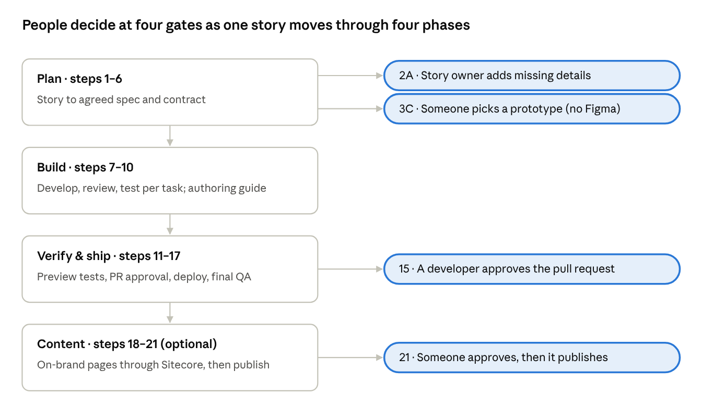

# Agentic Delivery Flow: Reference Guide

Oct 25, 2026 · Created by Archana Singh

This guide explains the agentic delivery flow: how a user story moves from Azure DevOps to a tested, deployed Sitecore AI (XM Cloud) and Next.js component, and optionally to published content. Specialised AI agents do the work, a script runs them in order, and people approve at four gates. It describes diagram **v6** and is meant to be read on its own or alongside the diagram.

## About this document

This is a reference for anyone on the team who wants to understand, review or later build the flow.

- **Status:** a design for review, not a running system. Nothing described here is implemented yet.
- **Companion files:** the interactive diagram [`diagram-versions/agentic-flow-v6.html`](../diagram-versions/agentic-flow-v6.html) (best viewed in a browser) and the image [`agentic-flow-v6.png`](../diagram-versions/agentic-flow-v6.png), both in this repository. The [`CHANGELOG.md`](../diagram-versions/CHANGELOG.md) records every version.
- **How it's organised:** sections 1–5 explain the idea and the concepts, sections 6–9 go through every step phase by phase, sections 10–14 cover states, connectors, skills, guardrails and open items, and the end has an FAQ and a glossary.
- **Terms:** technical terms get a short explanation in brackets the first time they appear. All of them are also in the glossary.

## 1. Why this flow exists

Our product manager asked how far our delivery process can be agentified (handed to AI agents, with people approving at the important points), and where. This flow is the answer.

It covers one user story end to end, from "ready" in Azure DevOps to a deployed, tested component, and optionally to authored content on real pages. Every step is done by one of three things:

- **A specialised AI agent**, with one job.
- **A script**, where the work is predictable and AI isn't needed.
- **A person**, at a clearly marked approval gate.

Nothing is a black box. For each step the diagram shows which agent runs it, which tools it uses, what it remembers, and what the story's state is in Azure DevOps.

## 2. The flow at a glance

One user story passes through 4 phases and 21 numbered steps, with people deciding at 4 gates.

1. **Plan (steps 1–6):** turn the story into an agreed spec and contract.
2. **Build (steps 7–10):** write the code and Sitecore items, review them, test them, and write the authoring guide.
3. **Verify & ship (steps 11–17):** raise the pull request, test on the preview, approve, merge, deploy, and run a final QA.
4. **Content (steps 18–21, optional):** create real pages with the new component, on brand, then publish.

Each phase starts from an event, and the flow pauses at each gate until a person acts.

**Swimlanes.** Across the diagram are seven lanes (columns grouping the steps by type of work, a standard process-diagram layout): Product & Requirements, Architecture & Planning, Development, Code Quality & Security, Testing & Validation, Release & Deployment, and Content Operations. A step sits in the lane of the work it does. Lanes are categories of work, not teams.

**Human gates.** People stay in control at four points, drawn as red rounded boxes. The story owner adds missing details (2A), someone picks a prototype when there's no Figma design (3C), a developer approves the pull request (15), and someone approves publishing (21). No agent merges or publishes without a person's approval.

| In numbers | Count |
| --- | --- |
| Numbered steps (plus 2A, 3A–3C, 4A) | 21 |
| Agents, each with its own skill | 22 |
| Human gates | 4 |
| Azure DevOps states | 19 |
| Connectors (tools agents use) | 11 |
| Maximum rounds for any agent loop | 3 |

## 3. How to read the diagram

Every box in the diagram has the same four parts: the Azure DevOps state at the top, the step number and agent's name, a one-line job description, and coloured tags.

| Tag | Meaning | Example |
| --- | --- | --- |
| 🔌 Connector | An outside system the agent can use, through MCP | 🔌 Azure DevOps, 🔌 Figma (if URL) |
| 📘 Skill | The agent's reusable instructions, by name | 📘 write-prd |
| 🪝 Hook | An automatic check that always runs | 🪝 Dev only, never prod |
| 🧠 Memory | What the agent reads or writes | 🧠 Story memory |
| 🤖 AI decides | AI chooses the next move at this step | 🤖 AI decides the order |
| 📐 SDD / 🔁 Triad | The development approach the step belongs to (section 5) | 📐 SDD: shapes the spec |

**Arrows.** Solid arrows are the main flow. Orange dashed arrows are loops back, limited to 3 rounds. Grey dotted arrows are references, where an agent reads something without a handoff. The ‖ symbol means agents run in parallel.

**Toggles.** The HTML version has two checkboxes. "Show agentic concepts" hides the tags and panels for a simpler view of the flow, and "Show ADO states" hides the state badges. The lane headers stay visible while you scroll.

## 4. Agentic concepts used

The flow is built from eight standard agentic building blocks. The three panels at the top of the diagram summarise them.

**1. Subagents.** Every box is a subagent: a separate AI worker with its own context (its working memory for one task) and its own tools. It hands back only its result. Keeping contexts separate stops one agent's mistakes or assumptions from leaking into the next, and means a fresh agent always checks another agent's work.

**2. Orchestration.** A scripted orchestrator runs the flow. It runs steps in order, starts parallel steps together, counts loop rounds, sets the Azure DevOps state and pauses at human gates. Because it's plain code, it costs nothing in AI usage and behaves the same every time. AI makes the flow decision in only two places, marked 🤖: the Task Planner decides the order of work (step 5), and the Contract Agent can send the plan back (step 6). Using code for the predictable parts and AI only where judgement is needed is standard practice: it's cheaper, faster and easier to debug.

**3. Event-driven phases.** Events start each phase: a story marked ready, a pull request approved, a publish approved. Progress is saved in story memory, so the flow can wait hours or days at a gate and continue where it stopped.

**4. Memory.** There are three kinds:

- **App memory**, shared and in the repo: `AGENTS.md` with the project's conventions and shared rules, the blueprint, and lessons learned. It applies to every story.
- **Story memory**, one folder per story: PRD, design reference, spec, task list, contract, fix and bug lists, and loop counts. This is how agents hand work to each other.
- **Developer memory**: each developer's personal `CLAUDE.md`. It's git-ignored and not used by the automated flow.

**5. Skills (📘).** A skill is a packaged set of instructions an agent loads when it needs them. Each agent has exactly one skill with an agreed name (section 12).

**6. Hooks (🪝).** A hook is a check that always runs, whatever the agent decides. An instruction can be ignored by a model, but a hook can't. The flow uses four: auto-format and lint after every FE edit, run tests on change, the existing pre-commit checks, and a lock that keeps the BE Agent on the dev environment.

**7. Connectors (🔌) through MCP.** Connectors let agents use real systems such as Azure DevOps, GitHub, Figma, Sitecore, Vercel and browsers. They use MCP (Model Context Protocol), the open standard for plugging tools into AI, like a USB port for AI tools.

**8. Plugin and harness.** The whole flow (agents, skills, hooks and connectors) is packaged as one team plugin, so every developer runs the same version. It runs on Claude Code when used interactively and on the Claude Agent SDK in CI for automated runs. These are the harness (the program that runs the agents and gives them tools). Using an existing harness means we don't build or maintain our own AI framework.

## 5. Development approach: SDD and the build triad

The flow is spec-driven, and every task is built, reviewed and tested by three separate agents. The diagram marks these with 📐 SDD and 🔁 Triad tags.

**Spec-driven development (SDD).** The spec is written and agreed before any code, and everything after follows it.

- Steps 2–6 shape the spec: PRD, review, spec, task list, contract.
- Step 7 builds from it.
- Steps 13 and 17 check the result against it.

"Done" therefore always means "matches the spec", not "the agent thinks it's finished". SDD is a growing pattern for AI-assisted development. Agents work far better from a precise written spec than from a vague request, and the spec also serves as the yardstick for QA.

**Build triad: develop → review → test, per task.** For each task, in the Task Planner's order, three separate agents work in turn:

1. **Develop (step 7):** FE and BE agents build.
2. **Review (step 8):** Code Quality and Security agents check the code.
3. **Test (step 9):** the Test & Storybook Agent writes and runs the tests and stories.

Review findings and failing tests go back to step 7, at most 3 rounds. A component is done only when it has its code, business logic, unit tests and a Storybook story, kept together. This matches how the team's developers work today.

**Why it isn't called TDD.** Test-driven development (TDD) means the tests are written before the code. This flow develops, reviews, then tests, so calling it TDD would be inaccurate. The triad is a recognised agentic pattern in its own right: a fresh agent checks each stage.

**Why testing is a separate agent.** Developers on the team write their own tests, but an AI agent testing its own code tends to write tests that confirm what it built, mistakes included. A separate test agent keeps the tests independent. The result per component is the same.

## 6. Phase 1: Plan (steps 1–6)

Plan turns a user story into an agreed spec and contract before any code is written. It starts when a story is marked ready in Azure DevOps, and pauses only at 2A (missing details) and 3C (prototype pick).

| Step | Agent or gate | What it does | ADO state | Tools and skill |
| --- | --- | --- | --- | --- |
| 1 | User story arrives | Story marked ready; may include a Figma URL. The orchestrator opens its story memory | New | Azure DevOps |
| 2 | PRD Agent | Checks the story against a readiness checklist, then writes the PRD from the story and its Figma design, if there is one | Drafting Requirements | Azure DevOps, Figma · `write-prd` |
| 2A | 👤 Story owner | Answers the PRD Agent's questions (ADO comment with @mention), updates the story, moves it back to Drafting Requirements. Reminder after 2 working days | 👤 Awaiting Story Details | — |
| 3 | PRD Review Agent | Challenges the PRD, checks it matches the Figma design, sends gaps back to step 2 (max 3 rounds) | Reviewing Requirements | Figma · `review-prd` |
| 3A | Decision | Figma URL in the story? Yes → Figma is the design reference, go to 4. No → 3B | Reviewing Requirements | Figma |
| 3B | Prototype Agent | Builds 3 clickable prototype variants from the reviewed PRD (only if there's no Figma URL) | Design | `build-prototypes` |
| 3C | 👤 A person | Picks one prototype; it becomes the design reference | 👤 Awaiting Design Pick | — |
| 4 | Spec Agent | Turns the final PRD into the spec, recording the design reference | Finalizing Requirements | `write-spec` |
| 4A | Blueprint Agent | Picks the base reference component all development follows. Runs once, in parallel, and refreshes when the repo changes | none (not tied to a story) | Sitecore (read), Sitecore Docs MCP · `pick-blueprint` |
| 5 | Task Planner Agent 🤖 | Splits the spec into tasks and plans parallel or sequential work from their dependencies | Finalizing Requirements | `plan-tasks` |
| 6 | Contract Agent 🤖 | Agrees the base model (template fields, rendering name, component props). Can send the plan back to step 5 if it finds a new dependency (max 3 rounds) | Finalizing Requirements | Sitecore Docs MCP · `define-contract` |

**Key design points**

- **Readiness first (2, 2A).** The PRD Agent never guesses missing information. It asks the story owner. This is the "Definition of Ready" idea: a story must meet a checklist before work starts. The 2A loop has no round limit because a person is already answering. If the PRD Agent needs a person to fill a gap found in review (3), it uses the same 2A step, so there's only one route to a human.
- **One design reference.** Figma, or the chosen prototype, is the single source of truth for how the result should look. Prototypes are built from the reviewed PRD, so a change made in review doesn't force new prototypes.
- **Blueprint once (4A).** The blueprint is shared across all stories and stored in app memory. It reads the real Sitecore setup rather than guessing.
- **Dependencies decide the order (5),** not the number of tasks.
- **Contract-first (6).** The contract is the agreement between front end and back end, like agreeing an API before building both sides. It lets the FE and BE agents work in parallel without FE waiting for BE.

## 7. Phase 2: Build (steps 7–10)

Build produces reviewed, tested code and Sitecore items for each task, plus the authoring guide, all checked locally before a pull request exists. It continues automatically after Plan and runs the develop → review → test triad once per task.

| Step | Agent | What it does | ADO state | Tools and skill |
| --- | --- | --- | --- | --- |
| 7 | FE Agent ‖ BE Agent (🔁 develop) | Both read the blueprint and contract, then work in parallel. FE builds the Next.js component; BE creates Sitecore items on dev and serializes them to YML, ready to commit (it doesn't commit) | In Development | FE: Figma, Sitecore Docs MCP, Next.js DevTools MCP, Storybook MCP · `build-component`. BE: Sitecore dev, Sitecore Docs MCP · `create-sitecore-items` |
| 8 | Code Quality Agent ‖ Security Agent (🔁 review) | Review the code against local Sonar rules (complexity, size, no `any`) and scan for vulnerabilities. Findings merge into one fix list → step 7 (max 3 rounds) | Quality Checks | `check-code-quality`, `scan-security` |
| 9 | Test & Storybook Agent (🔁 test) | Writes unit tests (the 4 required cases: valid data, missing fields, editing mode, error state) and Storybook stories; checks the stories in a browser; ensures 70% coverage. Failing tests → step 7 (max 3 rounds) | Testing | Playwright MCP, Storybook MCP · `write-tests-and-stories` |
| 10 | Authoring Guide Agent | Writes a guide for content authors as a Markdown (.md) file. It ships in the PR and the orchestrator attaches it to the ADO story | Preparing Authoring Guide | Sitecore Docs MCP · `write-authoring-guide` |

**Key design points**

- **Hooks guard step 7:** code is auto-formatted and linted after every edit, and the BE Agent is locked to dev, so it can never touch production. Step 9 runs tests on every change.
- **Reuse before build:** the FE Agent uses the Storybook MCP to find existing components to reuse, and the Next.js DevTools MCP to see live build, runtime and type errors from the local dev server.
- **Serialization** (exporting Sitecore items as YML files so they live in git) gives every environment the same items. The BE Agent creates items directly on the shared dev environment, then serializes them. The PR Agent commits later.
- **Shift left:** Sonar-style rules run locally before the PR, so problems are caught early and cheaply, and the PR rarely fails in CI. Lessons learned from reviews go into app memory for future stories.
- **Guide on the story:** the guide is replaced on the story whenever a fix round rewrites it, so the story always holds the latest version. Steps 12, 17 and 18 read it from there. Markdown was chosen over Word because it's cheaper for an agent to write, changes show line by line in the PR, and Azure DevOps can display it.

## 8. Phase 3: Verify & ship (steps 11–17)

Verify & ship tests the change on a real preview, waits for a person to approve the pull request, then deploys and runs a final QA on dev. It pauses at step 15 and resumes when the PR is approved.

| Step | Agent or gate | What it does | ADO state | Tools and skill |
| --- | --- | --- | --- | --- |
| 11 | PR Agent | Commits code + YML + guide in one PR and checks the Vercel preview build. The existing pre-commit checks (secretlint, lint-staged) run | Preview Testing | GitHub, Vercel MCP · `raise-pr` |
| 12 | Test Page Agent | Builds a test page on dev by following only the authoring guide, which also tests the guide | Preview Testing | Marketer MCP (dev) · `build-test-page` |
| 13 | Preview QA Agent ‖ Performance Agent | On the preview URL. QA checks the PRD's acceptance criteria and the design, then adds Playwright end-to-end tests to the PR. Performance measures speed | Preview Testing | QA: Playwright MCP, Vercel MCP · `test-preview`. Performance: Chrome DevTools MCP, Vercel MCP · `check-performance` |
| 14 | Bug Raising Agent (only if issues) | Logs bugs as ADO child items of the story, with Vercel logs as evidence, and reports them → step 7 (max 3 rounds) | Preview Testing | Azure DevOps, Vercel MCP (logs) · `raise-bugs` |
| 15 | 👤 Developer | Reviews and approves the PR in GitHub. The flow pauses here | 👤 Awaiting PR Approval | — |
| 16 | Merge & Deploy Agent | Merges, deploys to Vercel and Sitecore dev, and confirms the deployment | Deployment in Progress | GitHub, Vercel MCP, Sitecore dev · `merge-and-deploy` |
| 17 | QA Expert | Full test on dev against the final spec, using the guide | Under QA Review → Done if there's no content phase | Playwright MCP, Marketer MCP (read) · `run-full-qa` |

**Key design points**

- **Preview first.** A preview is a temporary copy of the site built for one PR. Testing there finds problems before merging, not after.
- **The guide is tested by use (12).** If an agent can't build a page from the guide, an author won't be able to either.
- **Regression tests (13).** QA's checks become Playwright end-to-end tests that stay in the repo, so the same checks run on every future change.
- **Final gate unchanged (15).** SonarQube and CodeQL in GitHub remain the final automated gate on every PR, as today. Only a person can approve the merge.

## 9. Phase 4: Content (steps 18–21, optional)

The optional Content phase puts the new component to work on real pages, on brand, and publishes only after a person approves. It starts after deploy; dashed borders on the diagram mark these steps as optional.

| Step | Agent or gate | What it does | ADO state | Tools and skill |
| --- | --- | --- | --- | --- |
| 18 | Content Authoring Agent | Prepares pages using the Sitecore Brand Kit and the authoring guide from the story. Dev first; the real authoring environment later | Content Authoring | Marketer MCP · `author-content` |
| 19 | Content Review Agent | Checks pages against brand and standards; off-brand work goes back to 18 (max 3 rounds) | Content Authoring | Marketer MCP (read) · `review-content` |
| 20 | Final Page Report (script, not AI) | Lists the preview URL, item path and GUID for each page | Content Authoring | Sitecore (query) |
| 21 | 👤 A person | Approves, then the pages are published | 👤 Awaiting Publish Approval → Done | — |

**Key design points**

- **Not everything needs AI (20).** Listing URLs and IDs is predictable work, so a plain script does it. Scripts are cheaper and always give the same answer.
- **Dev first (18).** Content is prepared on dev until the team trusts the process, then on the real authoring environment.
- **Nothing goes live without approval (21).**

## 10. Azure DevOps states

The story moves through 19 states, one per stage, so anyone can see on the board exactly where it is. States marked 👤 mean a person is needed.

- **Who sets them:** the orchestrator script sets each state as a stage starts, at no AI cost. Each agent adds a comment to the story describing what it did.
- **What they're for:** people. Agents coordinate through the orchestrator and story memory, not through the state. That avoids a race condition (two parallel agents updating the same field, one overwriting the other).
- **Fix rounds** return the story to In Development.

| # | State | Set at step |
| --- | --- | --- |
| 1 | New | 1 |
| 2 | Drafting Requirements | 2 |
| 3 | 👤 Awaiting Story Details\* | 2A |
| 4 | Reviewing Requirements | 3, 3A |
| 5 | Design\* | 3B |
| 6 | 👤 Awaiting Design Pick\* | 3C |
| 7 | Finalizing Requirements | 4, 5, 6 |
| 8 | In Development | 7, and every fix round |
| 9 | Quality Checks | 8 |
| 10 | Testing | 9 |
| 11 | Preparing Authoring Guide | 10 |
| 12 | Preview Testing | 11–14 |
| 13 | 👤 Awaiting PR Approval | 15 |
| 14 | Deployment in Progress | 16 |
| 15 | Under QA Review | 17 |
| 16 | Content Authoring\* | 18–20 |
| 17 | 👤 Awaiting Publish Approval\* | 21 |
| 18 | Done | end of the flow |
| 19 | 👤 Needs Human | any time a loop reaches 3 rounds |

\* Only when that step is used.

These are custom states, so an Azure DevOps admin has to add them to the work item process before implementation.

## 11. Connectors and MCP servers

Agents use 11 connectors, each only on the steps that need it. Seven are official MCP servers from Sitecore, Vercel, Microsoft (Playwright), Storybook and Google (Chrome DevTools).

For example, the Vercel MCP isn't on the FE Agent. While it's coding nothing is deployed yet, so it uses the Next.js DevTools MCP to see live errors instead.

| Connector | Steps | What it gives the agent | Before implementation |
| --- | --- | --- | --- |
| Azure DevOps | 1, 2, 14 | Read stories, post questions, log bugs | — |
| GitHub | 11, 16 | Commit, raise the PR, merge | — |
| Figma | 2, 3, 3A, 7 | The design, when the story has a Figma URL | — |
| Sitecore dev (CLI) | 4A, 7, 16, 20 | Templates, renderings, items, serialization, deploy | — |
| Sitecore Marketer MCP | 12, 17, 18, 19 | Pages, content, components, Brand Kit | Sign-in for automated runs; point it at dev |
| Sitecore Docs MCP | 4A, 6, 7, 10 | Official Sitecore developer docs | Confirm the server address |
| Vercel MCP | 11, 13, 14, 16 | Preview build status and logs, protected previews, runtime errors, deploy status | Browser sign-in for automated runs |
| Next.js DevTools MCP | 7 | Live build, runtime and type errors from the local dev server | Built into Next.js 16 |
| Playwright MCP | 9, 13, 17 | Drives a real browser; writes end-to-end tests | — |
| Storybook MCP | 7, 9 | Finds existing components and docs; writes and tests stories | Needs Storybook 10 (we're on 8.6); still in preview |
| Chrome DevTools MCP | 13 | Performance traces and speed insights | — |

The Marketer MCP can't create templates or renderings, which is why the BE Agent keeps the Sitecore CLI connector. A community Sitecore MCP server was considered and left out, because Sitecore doesn't support it and it would need a security review.

## 12. Skill names

Each of the 22 agents has exactly one skill with an agreed name, so team members can build them independently without naming clashes.

- **Naming pattern:** verb then object, lowercase with hyphens, for example `write-prd`.
- **Shared rules** that several agents need (Sonar rules, Sitecore template rules, brand standards) live once in `AGENTS.md`. Each skill points to them instead of copying them, so they can't drift apart.
- **Templates and checklists** specific to one agent, such as the PRD template or story readiness checklist, live inside that agent's skill.

| Step | Agent | Skill |
| --- | --- | --- |
| 2 | PRD Agent | `write-prd` |
| 3 | PRD Review Agent | `review-prd` |
| 3B | Prototype Agent | `build-prototypes` |
| 4 | Spec Agent | `write-spec` |
| 4A | Blueprint Agent | `pick-blueprint` |
| 5 | Task Planner Agent | `plan-tasks` |
| 6 | Contract Agent | `define-contract` |
| 7 | FE Agent | `build-component` |
| 7 | BE Agent | `create-sitecore-items` |
| 8 | Code Quality Agent | `check-code-quality` |
| 8 | Security Agent | `scan-security` |
| 9 | Test & Storybook Agent | `write-tests-and-stories` |
| 10 | Authoring Guide Agent | `write-authoring-guide` |
| 11 | PR Agent | `raise-pr` |
| 12 | Test Page Agent | `build-test-page` |
| 13 | Preview QA Agent | `test-preview` |
| 13 | Performance Agent | `check-performance` |
| 14 | Bug Raising Agent | `raise-bugs` |
| 16 | Merge & Deploy Agent | `merge-and-deploy` |
| 17 | QA Expert | `run-full-qa` |
| 18 | Content Authoring Agent | `author-content` |
| 19 | Content Review Agent | `review-content` |

Step 20 is a script, so it has no skill, and steps 1, 3A and the 👤 gates aren't agents. Inside the team plugin, skills are automatically prefixed with the plugin name (for example `pluginname:write-prd`), so no extra prefix is needed.

## 13. Guardrails

Eight rules keep the agents controlled, auditable (you can see afterwards what each agent did and why) and cheap to run:

1. **Every agent loop stops after 3 rounds** and escalates to a person with a summary. The story goes to 👤 Needs Human. The only uncapped loop is 2A, where a person is already answering.
2. **No agent reviews or tests its own work.** A fresh agent always checks.
3. **People decide at 4 gates:** missing details, prototype pick, PR approval, publish.
4. **Agents never merge or publish on their own.** A person approves first.
5. **The BE Agent is locked to dev** by a hook, so it can never touch production.
6. **SonarQube and CodeQL in GitHub remain the final gate** on every PR, as today.
7. **The design reference is the single source of truth** for how things look: Figma, or the chosen prototype.
8. **Agents hand work over through story memory**, so every decision is written down and traceable.

Rules 3 and 4 are what's usually called "human in the loop". The ADO comments and story memory provide the audit trail.

## 14. Not yet in scope, and open items

Some capabilities are deliberately left for later, and a few decisions are still open.

**Planned for later** (listed in the diagram's "Later" box):

- **Worktrees for parallel agents:** separate working copies of the repo, so agents working at the same time don't edit the same files.
- **Model choice per agent:** a strong model for judgement-heavy steps, a cheaper one for simple steps, to control cost.
- **Observability:** a log of every agent run, its cost and its loop count.
- **Evals:** re-running past stories to check agent quality over time.
- **MCP setup details:** sign-in for automated runs (a Sitecore authentication API exists; Vercel uses a browser sign-in), pointing the Marketer MCP at dev, and confirming the Docs MCP address.
- **Storybook upgrade from 8.6 to 10,** so the Storybook MCP can be used.
- **On hold:** writing the shared `AGENTS.md`, and rules that keep agents out of files they shouldn't read.

**Open items to settle before building:**

- [ ] Coverage target: 70% for now. The real target still needs confirming (the SonarQube setting may be 95%; the Jest thresholds are 80% lines and 70% branches).
- [ ] Does every story need its own base component, or does the shared blueprint cover all stories?
- [ ] Where do the existing Playwright tests live and run, so new end-to-end tests follow the same setup?
- [ ] Serialization tooling details for the BE Agent.
- [ ] An ADO admin to add the custom states.
- [ ] Update the repo's `CLAUDE.md`, which still mentions Jira instead of Azure DevOps.

Evals are repeatable tests for AI quality, like a regression suite for agents. They're how the team would show the agents keep working well over time.

## 15. Proposed next step: a pilot

The proposed next step is a small pilot on one simple component story, covering Plan and Build (steps 1–10), with a developer watching each step. It would show real results before more of the flow is automated.

**What the pilot needs**

- Time to implement the orchestrator script, the first skills and the hooks.
- An Azure DevOps admin to add the custom states.
- Team access to the Sitecore Marketer MCP and the Vercel MCP.
- A decision on the Storybook upgrade from 8.6 to 10.

**What the pilot would measure**

- Time from "ready" to "PR raised".
- Loop rounds per step.
- How often a story needs 2A (missing details).
- Defects found at preview compared with after merge.

A good first candidate is a component that has a Figma design and few dependencies, so the first run is clean. The scope and measures are a proposal and haven't been agreed yet.

## Frequently asked questions

**How is this different from developers using an AI assistant in the IDE?**
An assistant helps one person with one task. This flow covers the whole process (requirements, build, review, test, deploy and content) with independent checks, human gates and tracking. The assistant is one tool; this is the workflow around it.

**What will it cost?**
There's no number yet; the pilot is meant to produce one. Cost is kept down by design: scripts do the predictable work, loops stop at 3 rounds, and using a cheaper model for simple steps is planned.

**What if an agent gets something wrong?**
It's caught at several layers. A fresh agent reviews (8), a separate agent tests (9), QA checks the preview against the spec (13), a person approves the PR (15), and SonarQube and CodeQL still gate the PR. After 3 failed rounds, a person takes over.

**Could it break production?**
The BE Agent is locked to dev by a hook, which enforces the rule rather than just requesting it. Agents can't merge or publish without a person's approval, and MCP connectors act with the signed-in user's own permissions.

**Will this replace developers?**
No. Developers own the skills, approve PRs, handle escalations and review results. Agents take the repetitive work: drafting, boilerplate, test writing, checks and reporting.

**Why so many agents instead of one?**
One agent doing everything loses focus and ends up checking its own work. Small, focused agents give better results, can run in parallel, and keep checks independent.

**Is this test-driven development?**
No. TDD means tests are written before the code. This flow develops, reviews, then tests, with a separate agent for each. It is spec-driven: everything is built and checked against the agreed spec (section 5).

**What happens if a user story is incomplete?**
The PRD Agent checks it first. If details are missing, it asks the story owner in Azure DevOps (2A) and waits rather than guessing.

**How will we know it's working?**
Through the pilot measures (section 15), the Azure DevOps board, and later observability (a log of every run and its cost) and evals (re-running past stories to check quality).

**How long will it take to build?**
That will be estimated once the pilot scope is agreed. It depends on how many steps the pilot covers.

## Glossary

One-line meanings for every term in the diagram and this guide.

| Term | Plain meaning |
| --- | --- |
| Agent / subagent | An AI worker with one job, its own context and tools; hands back only its result |
| Orchestrator | The script that runs the steps in order, starts parallel ones, counts loops and sets ADO states |
| AI orchestration (🤖) | A point where AI, not the script, decides the next move (steps 5 and 6 only) |
| Context | An agent's working memory for one task |
| Skill (📘) | A packaged set of instructions an agent loads when needed; one per agent here |
| Hook (🪝) | A check that always runs automatically; it can't be skipped by the model |
| MCP / connector (🔌) | Model Context Protocol: the standard "plug" that lets agents use outside tools |
| Plugin | The package that installs all agents, skills, hooks and connectors together |
| Harness | The program that runs agents and gives them tools (Claude Code, Claude Agent SDK) |
| App memory | Shared knowledge in the repo: `AGENTS.md`, the blueprint, lessons learned |
| Story memory | One folder per story: PRD, spec, tasks, contract, bug lists, loop counts |
| PRD | Product requirements document: what to build and why |
| Spec | The detailed, agreed description the code is built and tested against |
| Contract | The agreed fields, rendering name and props that let FE and BE work in parallel |
| Blueprint | The reference component every new component follows |
| SDD | Spec-driven development: spec first, then build and check against it |
| TDD | Test-driven development: tests written before the code (not what this flow does) |
| Build triad | Develop → review → test by three separate agents, per task |
| Definition of Ready | The checklist a story must pass before work starts (step 2) |
| Human in the loop | A person approves at set points before the flow continues |
| Serialization | Exporting Sitecore items to YML files so they live in git |
| Preview | A temporary copy of the site built for one pull request |
| Shift left | Catching problems as early as possible, where they're cheapest to fix |
| Race condition | Two processes updating the same thing at once, so one overwrites the other |
| Worktree | A separate working copy of the same repo, so parallel agents don't clash |
| Evals | Repeatable tests that check AI quality over time |
| Observability | Logs and metrics showing what each agent did and what it cost |
